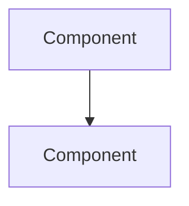

# Implementation Plan: <Task Title>

**Status:** Draft
**Date:** <YYYY-MM-DD>

## 1. Scope

- Task as understood: <one paragraph — restate the task precisely, incorporating any
  clarifying answers from Step 0>
- Explicitly out of scope: <bullet list, if anything was deliberately excluded>
- Assumptions made (if any question was skipped as unambiguous): <bullets>

## 2. Codebase findings

- Stack/architecture pattern in use: <e.g. "Node/Express, layered
  controller→service→repository, Postgres via Prisma">
- Related existing code found: <file paths + one-line description of each,
  with note on whether it's reused, extended, or superseded by this plan>
- Relevant conventions to follow: <naming, error handling, logging, testing —
  cite the file(s) that demonstrate each>
- Existing partial/abandoned attempts at this task, if any: <describe + what
  this plan does about them>

## 3. Approaches considered

### Option A: <name>

- What it is:
- Fit with existing architecture:
- Modularity:
- Scalability:
- Effort/complexity:
- Risk:

### Option B: <name>

(same structure)

### Option C: <name, if applicable>

(same structure)

### Recommendation

**Chosen: Option <X>.** <One paragraph rationale that explicitly weighs the
trade-offs above and says what's being given up by not choosing the others.>

## 4. Architecture

<Prose description, plus a Mermaid diagram if there are 3+ interacting
components:>

## 5. Data model changes

<Schema/field/migration changes, with backward-compatibility notes if
relevant. "None" if not applicable.>

## 6. Interface changes

<New/changed API routes, function signatures, events, config keys. "None" if
purely internal.>

## 7. File-by-file plan

**New files**

| Path | Purpose |
| ---- | ------- |
|      |         |

**Modified files**

| Path | Change |
| ---- | ------ |
|      |        |

## 8. Step-by-step tasks

- [ ] 1. <foundational piece>
- [ ] 2. <...>
- [ ] 3. <...>
- [ ] ... (ordered for safe incremental delivery — foundation → feature → integration → cleanup)

## 9. Modularity notes

<Specific boundaries/interfaces this design relies on and why they keep
concerns separated.>

## 10. Scalability notes

<The specific load/scale assumption this is built for, and what the next
step is if that assumption is exceeded.>

## 11. Best practices checklist

- [ ] Error handling: <specific new failure modes and how they're handled>
- [ ] Logging/observability: <what's newly logged/monitored>
- [ ] Security: <authz/input validation/secrets handling specific to this change>
- [ ] Config/rollout: <feature flag or staged rollout plan, if applicable>

## 12. Testing strategy

<Unit/integration/e2e coverage plan, referencing the repo's actual test
framework and conventions. Note any existing tests likely to need updates,
and any area with no current coverage.>

## 13. Risks & open questions

- <anything unresolved from the codebase alone that needs a human decision>
