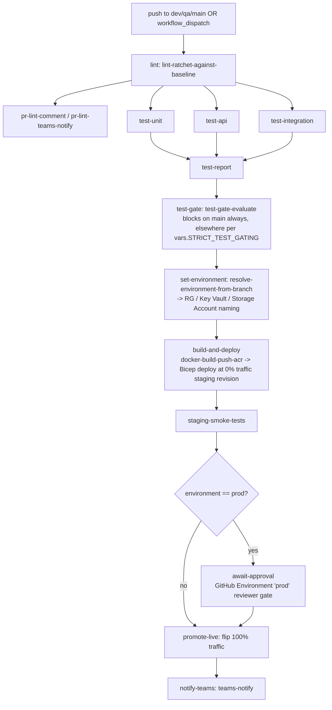
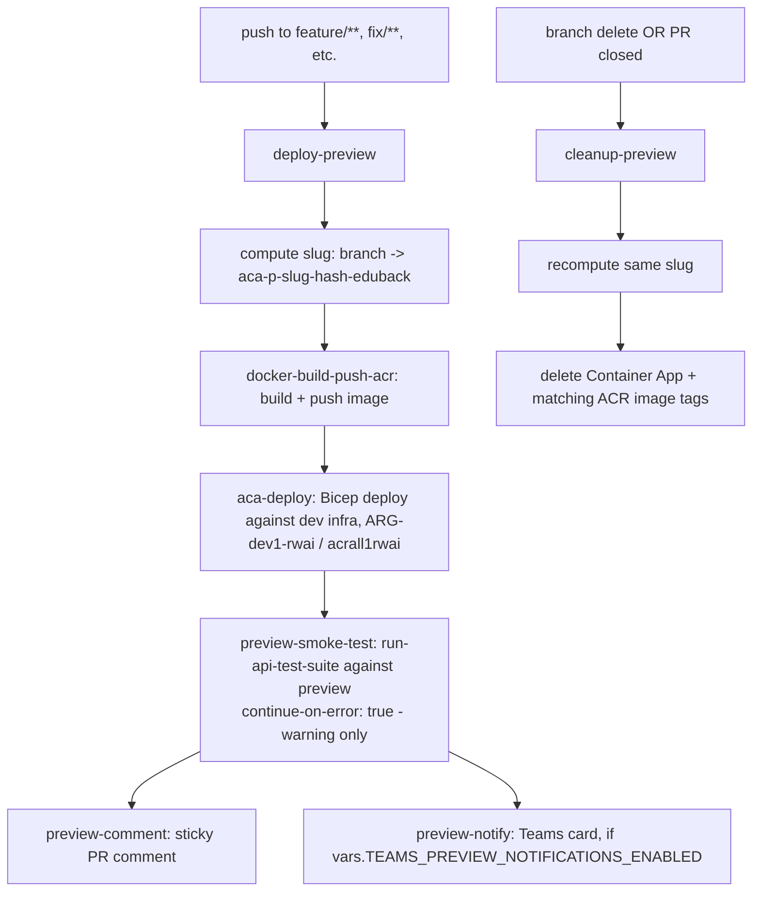

# CI/CD Pipeline Flow — Educator App Backend

This doc explains **how the pipeline actually flows end-to-end** and lists **every variable/secret it currently reads**. For the feature-by-feature implemented/planned tracker, see [`CI-CD-FEATURES.md`](./CI-CD-FEATURES.md); for the fuller deploy/rollback runbook, see [`DEPLOYMENT.md`](./DEPLOYMENT.md).

## 1. Which workflow runs when

| Trigger | Workflow | Purpose |
|---|---|---|
| Push to `dev`/`qa`/`main`, path-filtered to `src/**`, `Dockerfile`, `package*.json`, `infra/**` | `deploy-backend.yml` | Lint → test → build → staging deploy → smoke → (prod: approval) → promote |
| `pull_request` into `main`/`qa` | `deploy-backend.yml` test/lint jobs + `sast.yml` | Pre-merge checks |
| `workflow_dispatch` (`environment`, `image_tag`) | `deploy-backend.yml` | Manual deploy, guarded so the dispatching branch must match the target environment |
| Push to `feature/**`, `fix/**`, `bug/**`, `epic/**`, `chore/**`, `devops/**`, `ci/**`, `infra/**`, `release/**` | `preview-deploy.yml` | Stand up an ephemeral per-branch Container App preview on dev infra |
| Branch delete, or PR to `main`/`qa`/`dev` closed, or manual dispatch | `preview-deploy.yml` (`cleanup-preview`) | Tear down that branch's preview (Container App + ACR image tags) |
| `deployment_status` = `waiting` | `notify-pending-approval.yml` | Teams card for a gated environment (e.g. `prod`) awaiting approval |
| Manual `workflow_dispatch` | `rollback.yml` | Roll a Container App back to a previous revision or explicit image SHA |
| Every PR + weekly Monday 03:00 UTC cron | `sast.yml` | Gitleaks + Trivy + Semgrep (CodeQL currently disabled — see below) |

## 2. Main deploy flow (`deploy-backend.yml`)

Important: the **approval gate sits right before the traffic flip**, not before build/deploy. A reviewer approving prod is approving "send 100% of traffic to a revision that already passed staging smoke," not the build itself. Image build/push uses `docker-build-push-acr` (GHA layer cache) instead of the old cache-less `az acr build`.

## 3. Preview environment flow (`preview-deploy.yml`)

Preview naming: `aca-p-<slug>-<hash>-eduback`, where `slug` = branch name lowercased/collapsed/**truncated to 10 chars** (shorter than the frontend's 15, because the shared ACR/RG here also hosts other apps' previews), `hash` = first 4 hex chars of a sha256 of the full branch name, and `eduback` is the actual collision-preventer against other apps sharing the same RG/ACR. Bicep's `revisionSuffix` uses `uniqueString(backendImageTag)` on the **full** tag rather than a naive truncation, specifically to avoid a bug where two different pushes would hash to the same revision suffix and fail to deploy.

> **Doc contradiction to resolve:** the shipped workflow code and `CI-CD-FEATURES.md` both describe `preview-smoke-test` as **warning-only** (`continue-on-error: true`, never blocks merge). But `DEPLOYMENT.md`'s "Preview Environments" section describes it as a **hard, required merge-check gate** and even gives a `gh api` snippet to register it as one. These two docs disagree with each other and with the actual job behavior — confirm which is intended and correct the stale one.

## 4. Rollback flow (`rollback.yml`)

Manual dispatch with `environment`, `target` (`previous` or `specific-sha`), `sha`, `dry_run`. Never rebuilds — either walks the target Container App's own revision history to find the previous one, or uses an explicit image SHA already in ACR. Now includes post-rollback health polling (30× 10s) plus a smoke curl to `/health`, folded into a single job (previously a separate `health-check` job).

## 5. SAST (`sast.yml`)

Runs on PRs and now also weekly (Mondays 03:00 UTC) to catch new CVE/rule signatures between PRs. Gitleaks and Semgrep block on findings; Trivy is warning-only (`exit 0` always, surfaces via `::warning::` + Teams/PR comment); CodeQL is currently **disabled** (`if: false`) due to a private-repo GitHub API permissions error on its init step.

## 6. Current variables and secrets

### Azure credentials (OIDC)
| Name | Type | Used by |
|---|---|---|
| `AZURE_CLIENT_ID` | secret | `deploy-backend.yml`, `preview-deploy.yml`, `rollback.yml` |
| `AZURE_TENANT_ID` | secret | same |
| `SUBSCRIPTION_ID` (hardcoded, not a secret — subscription IDs aren't considered sensitive) | workflow env | same |

### ACR / Container Apps naming (hardcoded workflow env, not secrets)
| Name | Value | Used by |
|---|---|---|
| `ACR_NAME` | `acrall1rwai` | `deploy-backend.yml`, `preview-deploy.yml` |
| `ACR_RG` | `ARG-all1-rwai` | same |
| `IMAGE_NAME` | `educator-backend` | same |
| `RESOURCE_GROUP` | `ARG-dev1-rwai` | `preview-deploy.yml` |
| `AZ_PREFIX` | `rwai` | `deploy-backend.yml`, `rollback.yml` |
| `APP` / `APP_CODE` | `edu` | `deploy-backend.yml` (`APP`), `rollback.yml` (`APP_CODE`) |
| `AZ_VER`/`AZ_VERSION` | `'1'` | `rollback.yml` |
| `SMOKE_TEST_PATH` | `/health` | `rollback.yml` |

### Bicep params (`infra/preview-deploy.bicep`)
`previewAppName`, `backendImageTag` (required); `location` (default `eastus`), `prefix` (default `rwai`), `app` (default `edu`), `azureVersion` (default `'1'`) — same naming scheme as the real `app-deploy.bicep`. Environment is hardcoded to `'dev'` since previews always run on dev infra.

### Backend URL / environment resolution
| Name | Purpose |
|---|---|
| `BASE_URL` | Override in `tests/api/utils/env.ts`'s `getBaseURL()` — when set, takes priority over the fixed prod/qa/dev switch. Set from `preview-deploy.yml` to point the API test suite at the live preview. |
| `NODE_ENV` | Resolved per environment in `deploy-backend.yml`'s `test-api` job; must be explicitly set or `env.ts`'s `|| 'dev'` fallback silently targets the wrong backend. |

### Test gating
| Name | Purpose |
|---|---|
| `STRICT_TEST_GATING` | `'true'` forces `test-gate` to block on any unit/API failure regardless of branch (main is always strict regardless) |
| `STRICT_SMOKE_GATING` | Documented as controlling whether staging smoke failure blocks `promote-live`; exact wiring wasn't visible in this PR's diff — verify against the live workflow |

### Notifications
| Name | Type | Used by |
|---|---|---|
| `TEAMS_WEBHOOK_URL` | secret | `deploy-backend.yml`, `rollback.yml`, `notify-pending-approval.yml` |
| `TEAMS_WEBHOOK_LINT_URL` | secret | `deploy-backend.yml`'s `pr-lint-teams-notify` job |
| `TEAMS_SAST_WEBHOOK_URL` | secret | `sast.yml`'s `teams-alert` job |
| `TEAMS_PREVIEW_WEBHOOK_URL` | secret | `preview-deploy.yml`'s `preview-notify` job |
| `POWER_AUTOMATE_SAST_WEBHOOK_URL` | secret | Referenced in `CI-CD-FEATURES.md` for a `power-automate-notify` action — that action's implementation wasn't part of this PR's diff, verify it exists |
| `TEAMS_NOTIFICATIONS_ENABLED` | repo/env var | `deploy-backend.yml`, `rollback.yml`, `notify-pending-approval.yml` |
| `TEAMS_PREVIEW_NOTIFICATIONS_ENABLED` | repo/env var | `preview-deploy.yml` |
| `LINT_NOTIFICATIONS_ENABLED` | repo/env var | Lint Teams card — listed in `CI-CD-FEATURES.md`, confirm current wiring |
| `GITHUB_TOKEN` | secret (default) | PR comments, `gh` lookups |

### `workflow_dispatch` inputs
| Name | Workflow | Purpose |
|---|---|---|
| `environment`, `image_tag` | `deploy-backend.yml` | Target environment and image tag override |
| `branch` | `preview-deploy.yml` | Manual preview trigger |
| `environment`, `target`, `sha`, `dry_run` | `rollback.yml` | Rollback target and mode |

## 7. Known gaps / things to double check

- **Preview smoke-test blocking behavior contradiction** between `DEPLOYMENT.md` (says hard gate) and the actual workflow/`CI-CD-FEATURES.md` (warning-only) — resolve before relying on either doc.
- `POWER_AUTOMATE_SAST_WEBHOOK_URL` and its consuming action aren't in this PR's diff — confirm it's actually wired up if `sast.yml` references it.
- `STRICT_SMOKE_GATING` wiring wasn't visible in this diff — confirm it's actually read by the `staging-smoke-tests`/`promote-live` job conditions.
- CodeQL is disabled in `sast.yml` due to a permissions error — tracked as a backlog item to re-enable.
