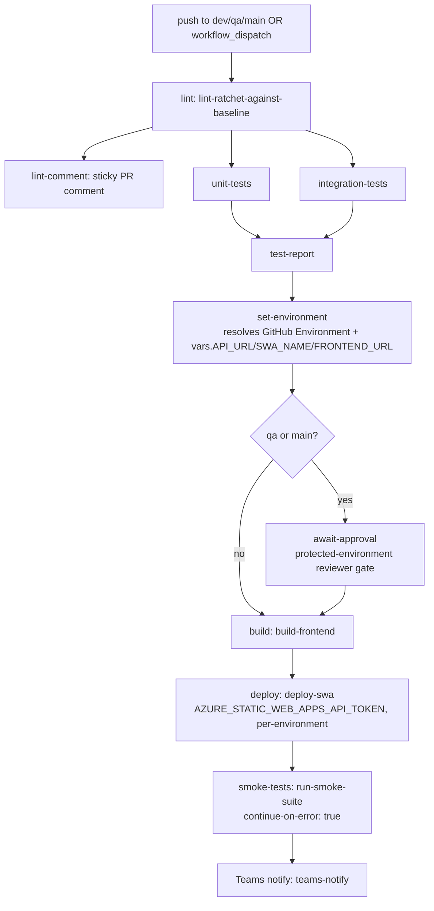
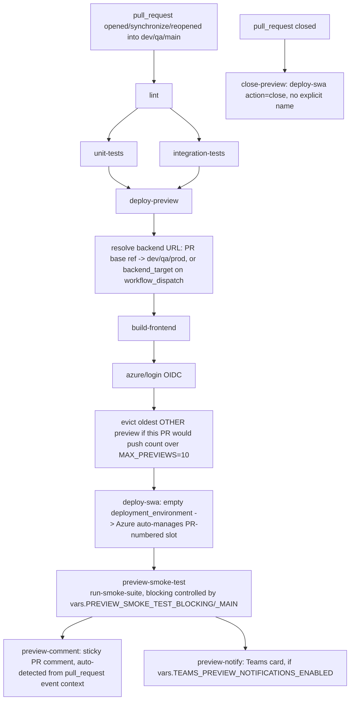

# CI/CD Pipeline Flow — Educator App Frontend

This doc explains **how the pipeline actually flows end-to-end** and lists **every variable/secret it currently reads**. For the feature-by-feature implemented/planned tracker, see [`CI-CD-FEATURES.md`](./CI-CD-FEATURES.md).

## 1. Which workflow runs when

| Trigger                                                                                                | Workflow                                            | Purpose                                                                            |
| ------------------------------------------------------------------------------------------------------ | --------------------------------------------------- | ---------------------------------------------------------------------------------- |
| Push to `dev` / `qa` / `main`                                                                          | `deploy-frontend.yml`                               | Lint → test → build → deploy to that real environment                              |
| `pull_request` (opened/sync/reopened) into `dev`/`qa`/`main`                                           | `deploy-frontend.yml` (lint/test jobs) + `sast.yml` | Pre-merge checks                                                                   |
| `workflow_dispatch` with `environment` input                                                           | `deploy-frontend.yml`                               | Manual deploy to a chosen environment                                              |
| `pull_request` (opened/sync/reopened) into `dev`/`qa`/`main`, path-filtered to app/test/workflow files | `preview-deploy.yml`                                | Stand up a per-PR preview on the dev SWA resource, in Azure's own PR-numbered slot |
| `pull_request` closed (into `dev`/`qa`/`main`)                                                         | `preview-deploy.yml` (`close-preview` job)          | Tear down that PR's preview                                                        |
| `deployment_status` = `waiting`                                                                        | `notify-pending-approval.yml`                       | Teams card: "deployment is waiting on your approval"                               |
| Manual `workflow_dispatch`                                                                             | `rollback.yml`                                      | Roll a real environment back to a previous SWA deployment                          |
| Every push, plus every PR                                                                              | `sast.yml`                                          | Gitleaks + Trivy scan                                                              |

## 2. Real-environment deploy flow (`deploy-frontend.yml`)

Key point: **smoke-test failure on a real environment does not fail the pipeline** — `continue-on-error: true` — it only shows up in the Teams card. The deploy has already happened by the time smoke tests run.

## 3. Preview environment flow (`preview-deploy.yml`)

This changed on 2026-07-24 from a push-triggered, custom-named-environment design (branch slug set as `deployment_environment` on every push, no PR required). That design is invisible to `az staticwebapp environment list/show/delete` — confirmed empirically (the CLI still showed only the `default` build while 9 named environments were live in the Portal) and by Microsoft's docs, which only document Portal-based deletion for named/branch environments. That made both real cleanup and eviction impossible to build reliably. Modeled on pxt-crexo's `deploy-swa.yml`: leaving `deployment_environment` empty on a `pull_request` event lets Azure auto-manage a PR-numbered slot instead — the thing `az staticwebapp environment` commands and the `close` action were actually built for. Tradeoff accepted: previews now only exist once a PR is open, not on every branch push.

`preview-smoke-test`'s blocking behavior is controlled by two repo variables keyed on which backend the preview resolved to: `vars.PREVIEW_SMOKE_TEST_BLOCKING_MAIN` (backend resolved to prod) and `vars.PREVIEW_SMOKE_TEST_BLOCKING` (everything else), both default `'false'` (warning-only, matching the real-environment pipeline). Flip either to `'true'` to make a failure fail the job for real for that backend tier, no workflow edit needed.

Backend selection now reads `github.event.pull_request.base.ref` directly (base `main` → prod backend, base `qa` → qa backend, anything else → dev backend) — no `gh pr list` lookup needed, since the workflow is literally triggered by the PR event. `workflow_dispatch`'s `backend_target` input still overrides this for manual test previews.

**Eviction at the preview cap:** before deploying, `deploy-preview` authenticates via OIDC (`azure/login`) and lists existing preview slots (`az staticwebapp environment list`). If this PR's slot (new or being updated, always excluded from the count) plus every _other_ PR's slot would exceed `MAX_PREVIEWS` (10 — `swa-dev1-rwai-edufront` is Standard tier), it deletes the oldest other slot(s) first (`az staticwebapp environment delete`, sorted by `createdTimeUtc`). Modeled directly on pxt-crexo's `Setup-Script.ps1 -Action evict-old-previews`.

## 5. Rollback flow (`rollback.yml`)

Manual `workflow_dispatch` with `environment`, `target`, `dry_run` inputs. Job is bound to the matching GitHub Environment, so a `main` rollback requires the same reviewer approval as a real deploy. All three environments now share the single `AZURE_STATIC_WEB_APPS_API_TOKEN` secret (environment-scoped) instead of three separately-named secrets.

## 4. SAST (`sast.yml`)

Runs on every push (not just PRs) so preview branches get scanned too. Gitleaks diffs against `github.event.pull_request.base.ref || 'dev'`. Trivy's exit code is now derived from the actual CRITICAL finding count (previously hardcoded to `0`, so it never failed the check regardless of findings).

## 5. Current variables and secrets

### Azure SWA deployment

| Name                                                            | Type                    | Used by                                                             | Purpose                                                                                                                                                                                                                                                                                                                                                                                                                               |
| --------------------------------------------------------------- | ----------------------- | ------------------------------------------------------------------- | ------------------------------------------------------------------------------------------------------------------------------------------------------------------------------------------------------------------------------------------------------------------------------------------------------------------------------------------------------------------------------------------------------------------------------------- |
| `AZURE_STATIC_WEB_APPS_API_TOKEN`                               | secret, per-environment | `deploy-frontend.yml`, `rollback.yml`                               | Deploy token for dev/qa/main (single name, value differs per GitHub Environment)                                                                                                                                                                                                                                                                                                                                                      |
| `AZURE_STATIC_WEB_APPS_API_TOKEN_DEV`                           | secret                  | `preview-deploy.yml`                                                | All previews live on the dev SWA resource, so previews always use the dev token explicitly                                                                                                                                                                                                                                                                                                                                            |
| `AZURE_CLIENT_ID` / `AZURE_TENANT_ID` / `AZURE_SUBSCRIPTION_ID` | secrets                 | `preview-deploy.yml` (`deploy-preview` job, OIDC via `azure/login`) | Added 2026-07-24 for real-time preview eviction (`az staticwebapp environment list/delete`). Authenticates as the existing `sp-Crexo-Educator-Frontend-dev` App Registration via a federated credential scoped to `repo:Realityworks-AI/Educator-App-Realityworks:environment:dev` — see `scripts/Setup-PreviewCleanupOidc.ps1`. `deploy-frontend.yml` still has no OIDC creds of its own and only ever uses the SWA deployment token |

### Build / SWA config

| Name                                                               | Type                          | Used by                                     | Purpose                                                                                                                         |
| ------------------------------------------------------------------ | ----------------------------- | ------------------------------------------- | ------------------------------------------------------------------------------------------------------------------------------- |
| `API_URL`                                                          | repo/env var                  | `deploy-frontend.yml`                       | Backend URL for the real-environment build, resolved per GitHub Environment                                                     |
| `SWA_NAME`                                                         | repo/env var                  | `deploy-frontend.yml`                       | SWA resource name, surfaced in notification cards                                                                               |
| `FRONTEND_URL`                                                     | repo/env var                  | `deploy-frontend.yml`                       | This app's deployed URL, surfaced in notification cards                                                                         |
| `NODE_VERSION`                                                     | workflow env (`'24'`)         | `deploy-frontend.yml`, `preview-deploy.yml` | Passed to build/test/smoke composite actions                                                                                    |
| `SWA_NAME` (hardcoded `swa-dev1-rwai-edufront`)                    | workflow env                  | `preview-deploy.yml`                        | Distinct from the per-environment `vars.SWA_NAME` above — previews always target this one resource                              |
| `RESOURCE_GROUP` (hardcoded `ARG-dev1-rwai`)                       | workflow env                  | `preview-deploy.yml`                        | RG for the preview SWA resource                                                                                                 |
| `MAX_PREVIEWS` (hardcoded `10`)                                    | workflow env                  | `preview-deploy.yml`                        | Standard-tier preview slot cap for `swa-dev1-rwai-edufront` — eviction target                                                   |
| `BACKEND_URL_DEV` / `BACKEND_URL_QA` / `BACKEND_URL_PROD`          | workflow env                  | `preview-deploy.yml`                        | Fixed backend URLs, resolved from the PR's base branch (or `backend_target` on manual dispatch)                                 |
| `PREVIEW_SMOKE_TEST_BLOCKING` / `PREVIEW_SMOKE_TEST_BLOCKING_MAIN` | repo vars (default `'false'`) | `preview-deploy.yml`                        | Toggle whether a smoke failure fails the job for real, split by whether the preview's backend resolved to prod (`_MAIN`) or not |

### `workflow_dispatch` inputs

| Name                               | Workflow              | Purpose                                                                                   |
| ---------------------------------- | --------------------- | ----------------------------------------------------------------------------------------- |
| `environment`                      | `deploy-frontend.yml` | Target dev/qa/main; guarded so the dispatching branch must match                          |
| `preview_name`                     | `preview-deploy.yml`  | Required — preview slot name for a manual test preview (no PR context to derive one from) |
| `backend_target`                   | `preview-deploy.yml`  | `dev`/`qa`/`prod`/`custom` — which backend the preview build points at                    |
| `custom_backend_url`               | `preview-deploy.yml`  | Required only when `backend_target = custom`                                              |
| `environment`, `target`, `dry_run` | `rollback.yml`        | Rollback environment, mode, and dry-run flag                                              |

### Notifications

| Name                                  | Type             | Used by                                                              | Purpose                                                                  |
| ------------------------------------- | ---------------- | -------------------------------------------------------------------- | ------------------------------------------------------------------------ |
| `TEAMS_WEBHOOK_URL`                   | secret           | `deploy-frontend.yml`, `rollback.yml`, `notify-pending-approval.yml` | Main deploy/rollback/approval Teams channel                              |
| `TEAMS_PREVIEW_WEBHOOK_URL`           | secret           | `preview-deploy.yml`                                                 | Separate channel for preview status, kept out of the main deploy channel |
| `TEAMS_SAST_WEBHOOK_URL`              | secret           | `sast.yml`                                                           | Separate channel for security findings                                   |
| `TEAMS_NOTIFICATIONS_ENABLED`         | repo/env var     | `deploy-frontend.yml`, `rollback.yml`, `notify-pending-approval.yml` | Master on/off switch for Teams notifications                             |
| `TEAMS_PREVIEW_NOTIFICATIONS_ENABLED` | repo/env var     | `preview-deploy.yml`                                                 | On/off switch for preview Teams cards                                    |
| `GITHUB_TOKEN`                        | secret (default) | all workflows using `pr-sticky-comment`/`gh`                         | PR comments, branch/PR lookups                                           |

### Test config

| Name           | Purpose                                                                                                                                                                                                                                  |
| -------------- | ---------------------------------------------------------------------------------------------------------------------------------------------------------------------------------------------------------------------------------------- |
| `BASE_URL`     | Set by `run-smoke-suite`; frontend URL the Playwright smoke suite targets. `playwright.smoke.config.ts` now prioritizes this over the old fixed dev/qa/prod URL matching, so preview URLs (which match none of those) resolve correctly. |
| `VITE_API_URL` | Backend URL used both to build the frontend and as the smoke suite's fallback URL-matching input                                                                                                                                         |

## 6. Known gaps / things to double check

- Preview smoke test is **warning-only** by default (`vars.PREVIEW_SMOKE_TEST_BLOCKING`/`_MAIN` = `'false'`), matching the sibling backend repo's equivalent gate (aligned 2026-07-24, after a recurring `06-class-create` login failure needed to stop blocking merges while it's investigated).
- Previews now only exist once a PR is opened against `dev`/`qa`/`main` — no more preview-on-plain-branch-push. Accepted tradeoff for real, working cleanup/eviction (see section 3).
- Eviction only considers previews already on `swa-dev1-rwai-edufront` (all backend targets share this one frontend resource) — it has no visibility into the backend's own preview environments.
